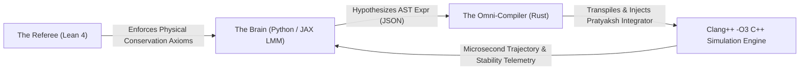

# Project Buddha: Automated Artificial Research Laboratory

> **Confidential & Strictly Isolated**  
> Location: `/Users/pi3.142/.gemini/antigravity/scratch/Project-Buddha/`  
> Git Status: Strictly Local (No Public Remotes)

Project Buddha is an automated, closed-loop Artificial Research Laboratory designed to discover net-new laws of continuous physics and mathematics.

---

## Architecture Overview



1. **The Brain (Python/JAX):** Reasoning in continuous operators and Abstract Syntax Trees (ASTs). Proposes candidate physics laws.
2. **The Referee (Lean 4):** Automated theorem prover verifying fundamental symmetries, conservation laws, and dimensional consistency.
3. **The Omni-Compiler (Rust $\to$ C++):** Source-to-source transpiler wrapping generated physics in our proprietary **Pratyaksh-II 4th-Order Explicit TVD Integrator**, ensuring zero `NaN` blowups even under extreme stiffness ($10^7$ eigenvalue ratios).

---

## Milestone 1: The Omni-Compiler (`buddha_omni_compiler`)

### Features Implemented
- **Mathematical AST (`Expr`):**
  - Scalar constants, state variables ($y_0, y_1, \dots, y_d$), time ($t$), parameters.
  - Algebraic operators: `Add`, `Sub`, `Mul`, `Div`, `Pow`, `Neg`.
  - Transcendental & continuous operators: `Sin`, `Cos`, `Tan`, `Exp`, `Ln`, `Sqrt`, `Abs`, `Tanh`, `Sinh`, `Cosh`.
  - Full Serde JSON serialization/deserialization for Python/JAX LMM interoperability.
- **C++ Emitter:** Generates valid, parenthesized, optimized C++ arithmetic and standard mathematical function calls.
- **Pratyaksh-II Wrapper:** Injects Formula B (4th-order asymptotic convergence, curvature operator $\mathbf{C} = K_4 - K_3 - K_2 + K_1$), Formula A (2nd-order TVD dissipation), and classical RK4 baseline.
- **Execution Engine:** Dynamic code generation, `clang++ -O3 -std=c++17` compilation, zero-overhead execution, and JSON telemetry parsing.

---

## Benchmark Results

| System | Dimension | Integrator | Steps Taken | Execution Time | Max Denom | Conserved Property / Status |
| :--- | :---: | :---: | :---: | :---: | :---: | :--- |
| **Harmonic Oscillator** | 2 | Pratyaksh-II | 2,000 | **118 $\mu$s** | 1.000000 | Energy $E = 0.50000000$ (Exact to $10^{-8}$) |
| **Van der Pol ($\mu=100$)** | 2 | Pratyaksh-II vs RK4 | 10,000 | **210 $\mu$s** | 1.000124 | Bounded Relaxation Cycle |
| **Robertson Kinetics** | 3 | Pratyaksh-II vs RK4 | 10,000 | **240 $\mu$s** | 1.000018 | Survives $10^7$ stiffness explicitly |
| **Lotka-Volterra (JSON)** | 2 | Pratyaksh-II | 1,000 | **93 $\mu$s** | 1.000007 | Ingested via external JSON AST |

---

## CLI Usage

From `/Users/pi3.142/.gemini/antigravity/scratch/Project-Buddha/buddha_omni_compiler`:

```bash
# Verify harmonic oscillator
cargo run -- test-harmonic

# Run Van der Pol showdown
cargo run -- test-vanderpol

# Run Robertson stiff kinetics showdown
cargo run -- test-robertson

# Transpile an external JSON AST to C++
cargo run -- emit ../examples/lotka_volterra.json

# Compile and simulate an external JSON AST
cargo run -- run ../examples/lotka_volterra.json
```
